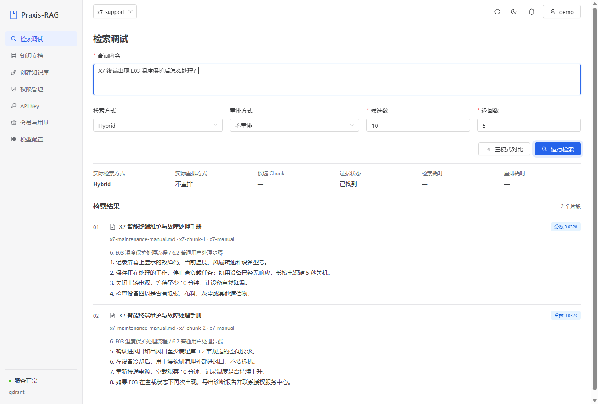
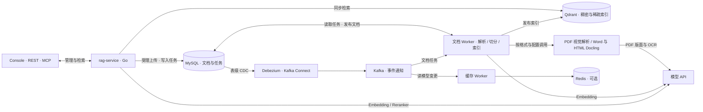

# Praxis-RAG

**面向 AI 助手和业务应用的自托管知识库，让检索结果可引用、可回查原文。**

[快速开始](#快速开始) · [系统架构](#系统架构) · [REST / MCP](docs/USAGE.md#5-rest-api-示例) · [版本发布](https://github.com/Guan0923/Praxis-RAG/releases)



*Console 界面演示使用仓库内的[X7 智能终端维护手册](examples/knowledge/x7-maintenance-manual.md)和本地示例响应。*

## 能做什么

- **把资料建成知识库。** 在 Console 批量上传 Markdown、TXT、PDF 和 Word，选择切分策略，后台完成解析与索引。启用 Docling 后可上传静态 HTML。
- **找回能引用的原文。** 在 Console 并排比较 BM25、Embedding 和 Hybrid，也可启用模型重排；配置抽取模型后可用 SAG 事件-实体检索跨 chunk 追溯关联证据。检索返回原文片段和来源，解析产物可带页码、表格、图片和公式。
- **让助手和业务系统查同一份资料。** Console 用于管理知识库和调试检索，MCP 供 AI 助手调用，REST API 供应用集成。调用方可用返回的证据组织答案。

## 系统架构



上传在 MySQL 保存任务后立即返回。文档 Worker 通过 Kafka 收到通知，异步完成索引。搜索在一次请求内返回命中片段和证据引用。[部署拓扑与进程清单](docs/DEPLOYMENT.md#1-进程拓扑)

## 运行指标与限制

| 指标 | 上限或默认值 | 口径 |
| --- | --- | --- |
| 批量上传 | **10 个文件/批**，**10 MiB/文件** | REST 批次上传与 Console |
| 单次搜索 | **100 个候选**，**10 条结果** | `candidate_k`、`top_k` 的请求上限 |
| 搜索超时预算 | **120 秒** | 默认值，可通过 `RAG_SEARCH_TIMEOUT_SECONDS` 调整 |
| 证据产物保留期 | **1 小时** | 默认值，可通过 `RAG_RESULT_TTL_SECONDS` 调整 |

这些数字来自请求校验与默认配置。部署验证和测试环境见[验证记录](VALIDATION.md)。

## 快速开始

在 Windows 上准备 PowerShell 7、Go 1.27+、Node.js 20.19+ 或 22.12+，以及 Docker Compose。首次在仓库目录启动时执行以下命令。

```powershell
Copy-Item .env.example .env
# 生成加密密钥，将输出填入 .env 的 RAG_STATE_ENCRYPTION_KEY
'base64:' + [Convert]::ToBase64String([Security.Cryptography.RandomNumberGenerator]::GetBytes(32))
# 在 .env 中填写 RAG_MYSQL_PASSWORD 和 MYSQL_ROOT_PASSWORD
pwsh -File scripts/build-go.ps1
pwsh -File scripts/start-stack.ps1
```

启动后打开本机 Console，注册账号并配置 Embedding 模型。创建知识库，上传X7 智能终端维护手册。等索引成功后，在「检索调试」输入「X7 终端出现 E03 温度保护后怎么处理？」即可查看来源片段。[打开 Console](http://127.0.0.1:8011/console) · [下载样例手册](examples/knowledge/x7-maintenance-manual.md) · [启动与冒烟说明](docs/USAGE.md#4-启动与冒烟)

| 接入方式 | 入口 |
| --- | --- |
| Web Console | `/console` |
| REST API | `POST /v1/search`，在线接口文档位于 `/docs` |
| MCP（Streamable HTTP） | `/mcp`，使用 `search` 查询证据 |

## 项目文档

| 文档 | 内容 |
| --- | --- |
| [使用指南](docs/USAGE.md) | 本地构建、管理员初始化、模型配置、REST 和 MCP 示例 |
| [部署指南](docs/DEPLOYMENT.md) | Compose、systemd、Kafka Connect、运行监控和升级 |
| [Kubernetes 部署](deploy/k8s/README.md) | Kustomize 清单、依赖配置和启动顺序 |
| [知识库权限](docs/PERMISSIONS.md) | 知识库归属、文档范围和邀请共享 |
| [证据产物与引用](docs/result-references.md) | Artifact 读取方式与保留策略 |
| [开发与测试](docs/USAGE.md#11-开发与测试) | Go 与 Console 的验证方式 |
| [Go 迁移记录](docs/GO_MIGRATION.md) | 历史契约、已完成的迁移和兼容性说明 |

## 许可证

[MIT](LICENSE)
