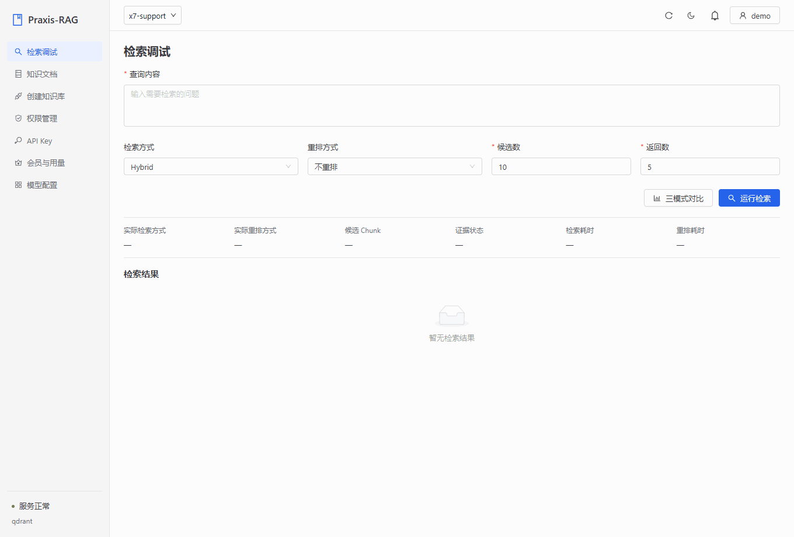
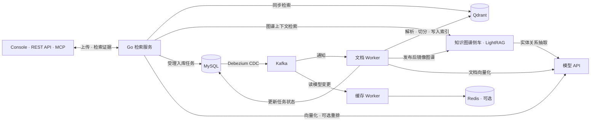

# Praxis-RAG

**Praxis-RAG 是面向 AI 助手和业务应用的自托管知识库，通过 Console、REST API 和 MCP 返回可回查原文的检索证据。**

[5 分钟快速开始](#5-分钟快速开始) · [使用指南](docs/USAGE.md) · [部署指南](docs/DEPLOYMENT.md) · [MIT 许可证](LICENSE)

## 演示



Console 使用示例响应展示混合检索。输入 E03 故障问题后，可以看到 [X7 维护手册](examples/knowledge/x7-maintenance-manual.md)中的处理步骤和来源章节。除 BM25 / Embedding / Hybrid 外，配置抽取模型后还可启用 SAG 事件-实体检索，跨 chunk 追溯共享实体的关联证据（见[使用指南](docs/USAGE.md#sag-事件-实体检索retrieval-sag)）。启用知识图谱后还可用图谱模式回答"这几份文件里的条款彼此是什么关系"这类跨文档关联问题，同样只提供证据、不生成答案（见[使用指南](docs/USAGE.md#知识图谱检索retrieval-graph)）。

## 5 分钟快速开始

准备 Git 和 Go 1.27+，运行内置示例检索。只需下载 Go 依赖，无需启动数据库或配置模型 API Key。

```sh
git clone https://github.com/Guan0923/Praxis-RAG.git
cd Praxis-RAG
go run ./cmd/rag-mcp-debug --query "RRF 怎么融合 BM25 和 Dense？" --limit 2
```

看到 `mode=mock` 和 `results=2` 即可验证示例。第一条结果的 `Text` 是原文片段，`Source` 是来源，`ChunkID` 标识片段。首次下载依赖的时间取决于网络。

[启动完整服务并导入 X7 手册](docs/USAGE.md#用-console-跑通文档导入与检索)

## 架构



[完整部署拓扑](docs/DEPLOYMENT.md#1-进程拓扑) · [REST API](docs/USAGE.md#5-rest-api-示例) · [MCP 接入](docs/USAGE.md#6-mcp-使用)

## 指标

| 指标 | 默认值 | 请求上限 |
| --- | --- | --- |
| 批量上传 | — | 10 个文件/批，10 MiB/文件 |
| 检索候选数 `candidate_k` | 10 | 100 |
| 单次返回数 `top_k` | 5 | 10 |
| 搜索超时预算 | 120 秒 | — |
| 证据产物保留期 | 1 小时 | — |

[配置与运行说明](docs/USAGE.md) · [证据引用与保留策略](docs/result-references.md) · [验证记录](VALIDATION.md)
